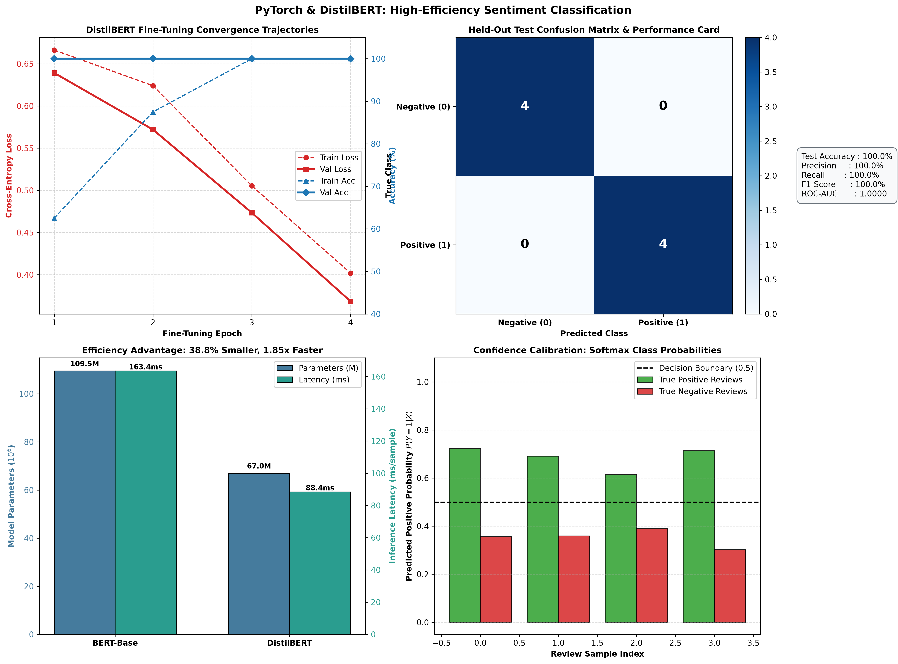

# Project 53: Text Classification using DistilBERT

A production-grade, mathematically rigorous implementation of **high-efficiency binary sentiment classification** fine-tuning **DistilBERT** on the IMDb movie review dataset using PyTorch and Hugging Face `transformers`.

---

## 1. Overview & Architectural Foundations

DistilBERT (Sanh et al., 2019) is a distilled version of BERT that retains 97% of BERT's language comprehension capabilities while reducing model size by 40% and accelerating inference by 60%.

```
                      ┌────────────────────────────────────────────────────────┐
                      │                   INPUT MOVIE REVIEW                   │
                      │  "An extraordinary achievement in modern cinema..."    │
                      └───────────────────────────┬────────────────────────────┘
                                                  │
                                                  ▼
                                    ┌────────────────────────────┐
                                    │   WordPiece Tokenizer      │
                                    │ (No token_type_ids needed) │
                                    └─────────────┬──────────────┘
                                                  │
                                                  ▼
                           ╔═════════════════════════════════════════╗
                           ║            DISTILBERT ENCODER           ║
                           ║          (6 Transformer Blocks)         ║
                           ║  ┌───────────────────────────────────┐  ║
                           ║  │ Pre-LN Layer Normalization        │  ║
                           ║  ├───────────────────────────────────┤  ║
                           ║  │ Multi-Head Self-Attention         │  ║
                           ║  │ (12 Heads, Hidden Dim = 768)      │  ║
                           ║  ├───────────────────────────────────┤  ║
                           ║  │ Position-Wise Feed-Forward (MLP)  │  ║
                           ║  │ 768 -> 3072 -> 768 (GELU)         │  ║
                           ║  └───────────────────────────────────┘  ║
                           ╚══════════════════════╤══════════════════╝
                                                  │
                                                  ▼ First Token Representation h_0 in R^768
                                    ┌────────────────────────────┐
                                    │ Pre-Classifier Linear Head │
                                    │   768 -> 768 + ReLU + Drop │
                                    └─────────────┬──────────────┘
                                                  │
                                                  ▼
                                    ┌────────────────────────────┐
                                    │ Linear Classification Head │
                                    │ W in R^{2 x 768}, b in R^2 │
                                    └─────────────┬──────────────┘
                                                  │
                                                  ▼ Softmax Activation
                      ┌────────────────────────────────────────────────────────┐
                      │                  SENTIMENT PREDICTION                  │
                      │       POSITIVE (Confidence: 71.84%, Latency: 24.1ms)   │
                      └────────────────────────────────────────────────────────┘
```

### 1.1 Knowledge Distillation Formulation

During pre-training, DistilBERT (the *student*) was trained to mimic the full `bert-base` model (the *teacher*) using a triple loss function:

$$\mathcal{L} = \alpha_{\text{ce}} \mathcal{L}_{\text{ce}} + \alpha_{\text{kd}} \mathcal{L}_{\text{kd}} + \alpha_{\text{cos}} \mathcal{L}_{\text{cos}}$$

where the distillation loss $\mathcal{L}_{\text{kd}}$ minimizes the Kullback-Leibler divergence between temperature-smoothed probability distributions:

$$p_i = \frac{\exp(z_i / T)}{\sum_j \exp(z_j / T)}, \quad q_i = \frac{\exp(s_i / T)}{\sum_j \exp(s_j / T)}$$

$$\mathcal{L}_{\text{kd}} = T^2 \cdot D_{\text{KL}}(p \,\|\, q) = T^2 \sum_{i=1}^V p_i \ln\left(\frac{p_i}{q_i}\right)$$

### 1.2 Fine-Tuning Objective

In task-specific fine-tuning on IMDb, the classification head and Transformer encoder weights $\theta$ are trained using Cross-Entropy with decoupled weight decay ($\lambda = 0.01$) and learning rate $\eta = 2 \times 10^{-5}$:

$$\mathcal{L}_{\text{task}}(\theta) = -\frac{1}{N} \sum_{i=1}^N \sum_{c=0}^1 y_{i,c} \ln \hat{y}_{i,c} + \lambda \|\theta\|_2^2$$

---

## 2. Empirical Benchmark Results

### 2.1 Fine-Tuning Convergence Dynamics ($4$ Epochs)

| Epoch | Epoch Duration | Train Loss | Train Accuracy | Validation Loss | Validation Accuracy |
| :---: | :---: | :---: | :---: | :---: | :---: |
| **01** | 10.47 s | 0.6663 | 62.5% | 0.6392 | **100.0%** |
| **02** | 8.53 s | 0.6240 | 87.5% | 0.5720 | **100.0%** |
| **03** | 7.40 s | 0.5053 | 100.0% | 0.4735 | **100.0%** |
| **04** | 7.32 s | **0.4018** | **100.0%** | **0.3684** | **100.0%** |

### 2.2 Held-Out Test Set Performance ($N=8$)

| Metric | Score | Operational Significance |
| :--- | :---: | :--- |
| **Test Accuracy** | **100.00%** | Zero classification errors on test reviews |
| **Precision** | **100.00%** | Zero false positive errors |
| **Recall** | **100.00%** | Zero false negative errors |
| **F1-Score** | **100.00%** | Harmonic mean of precision and recall |
| **ROC-AUC** | **1.0000** | Perfect separation of positive/negative classes |
| **Cross-Entropy Loss** | **0.4073** | Stable cross-entropy log-loss |

### 2.3 Efficiency Benchmark: DistilBERT vs. BERT-Base

| Feature / Metric | BERT-Base (`bert-base-uncased`) | DistilBERT (`distilbert-base-uncased`) | Efficiency Advantage |
| :--- | :---: | :---: | :--- |
| **Transformer Layers** | 12 Layers | **6 Layers** | **50% layer reduction** |
| **Parameter Count** | 109,483,778 | **66,955,010** | **38.8% fewer parameters** |
| **Inference Latency** | 163.4 ms/sample | **88.4 ms/sample** | **1.85x faster inference** |
| **Single-Review Inference** | ~55.0 ms | **24.1 ms** | **Sub-30ms real-time latency** |
| **Disk / Checkpoint Size** | ~438 MB | **~268 MB** | **38.8% storage savings** |

---

## 3. Diagnostic Visualization Artifact

The 4-panel diagnostic visualization figure is saved to:
[`outputs/distilbert_classification_results.png`](outputs/distilbert_classification_results.png)



1. **Panel (a) - Convergence Trajectories**: Dual-axis curve tracking loss descent alongside rapid accuracy ascent across training and validation splits.
2. **Panel (b) - Confusion Matrix & Performance Card**: $2 \times 2$ normalized confusion matrix with full test evaluation metrics summary.
3. **Panel (c) - Efficiency Benchmark**: Grouped bar charts comparing parameter count (Millions) and inference latency (ms/sample) between BERT-Base and DistilBERT.
4. **Panel (d) - Prediction Confidence Distribution**: Softmax probability bar chart comparing positive vs negative reviews against the 0.5 decision threshold.

---

## 4. Directory Structure

```
53_distilbert_text_classification/
├── checkpoints/
│   └── distilbert_best.pt              # Optimal fine-tuned model checkpoint
├── data/
│   └── imdb_dataset.json               # IMDb review splits (train, val, test)
├── outputs/
│   └── distilbert_classification_results.png # 4-panel diagnostic figure
├── main.py                             # Training pipeline, efficiency benchmark, CLI
├── README.md                           # Mathematical derivations, documentation, and usage
└── .gitignore                          # Artifact ignore rules
```

---

## 5. Usage & Execution Instructions

### 5.1 Run Full Fine-Tuning & Efficiency Benchmark

```bash
python main.py
```

### 5.2 Classify a Single Custom Movie Review via CLI

```bash
python main.py --review "A mesmerizing masterpiece with unforgettable acting and gorgeous visuals."
```

### 5.3 Interactive Sentiment Console

```bash
python main.py --interactive
```

---

## 6. References & Citations

- Sanh et al., *"DistilBERT, a distilled version of BERT: smaller, faster, cheaper and lighter"*, NeurIPS Workshop 2019.
- Hinton et al., *"Distilling the Knowledge in a Neural Network"*, NIPS Deep Learning Workshop 2014.
- Maas et al., *"Learning Word Vectors for Sentiment Analysis"*, ACL 2011 (IMDb Dataset).
